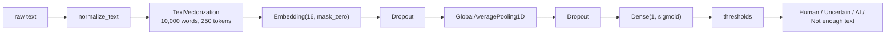

# Ghostink

*A from-scratch neural detector of AI-generated text — and an honest look at why this problem is so hard.*

[](https://github.com/TaniaW777/ghostink/actions/workflows/ci.yml)
[](LICENSE)
[](https://www.python.org/)
[](https://www.tensorflow.org/)

*Version française : [README.fr.md](README.fr.md)*

## Demo


Launch the app locally (after the setup in [Run it locally](#run-it-locally)):

```bash
python app/app.py
```

## Why this project

AI-generated text is now everywhere: in homework, in job applications, in news and in social
media posts. Teachers want to protect academic integrity, and readers want to know when
disinformation is produced at scale by a machine. Watermarks are not enough, because only the
company that built a model can read its watermark, and texts from other models carry none.
This project asks a simpler question: what can a small model, trained from scratch, really
learn about the difference between human and AI writing?

## Built from scratch

No pre-trained model is used anywhere: no transformer, no pre-trained embeddings, no detection
API. The vocabulary, the word embeddings and the decision thresholds are all learned from the
project's own data. Hugging Face is used only to download the datasets. The project started as
a course exercise, adapted from an IMDB sentiment-analysis notebook.

## Tech stack

| Tool | Used for |
|---|---|
| Python 3.13 | language |
| TensorFlow 2.21 / Keras 3 | `TextVectorization`, `Embedding`, `GlobalAveragePooling1D`, `Dense` |
| NumPy | arrays |
| pandas | data tables |
| scikit-learn | splits, metrics |
| Hugging Face `datasets` | loading the data only |
| Gradio | user interface |
| Matplotlib | figures |
| pytest | tests |
| ruff | linting |
| GitHub Actions | continuous integration |

## Data

Two public datasets from Hugging Face:

| Name in this project | Dataset | License |
|---|---|---|
| *recent* | [`silentone0725/ai-human-text-detection-v1`](https://huggingface.co/datasets/silentone0725/ai-human-text-detection-v1) | CC BY 4.0 (attribution required) |
| *abstracts* | [`Ateeqq/AI-and-Human-Generated-Text`](https://huggingface.co/datasets/Ateeqq/AI-and-Human-Generated-Text) | MIT |

- *recent* is a compilation. According to its dataset card, it includes texts from **HC3**
  (Human–ChatGPT comparison corpus), **RAID** (Real or AI-generated Discrimination benchmark)
  and **M4GT-Bench** (Multi-Model Generative Text benchmark), among other corpora listed on the
  card. Attribution: *AI vs Human Text Detection Dataset (v1)*, silentone0725, Hugging Face
  Datasets.
- *abstracts* contains original scientific abstracts and AI-generated abstracts written from
  the same titles.

**Cleaning** (v2 pipeline, `configs/v2.yaml`; counts from
[`reports/data_v2.json`](reports/data_v2.json)):

1. Every text goes through `normalize_text` (rejoined contractions, no URLs, fixed spacing
   around punctuation, no line breaks), for both classes. Empty texts are dropped.
2. Near-duplicates are removed: two texts are duplicates when their first 200 characters
   (lowercased, letters and digits only) are the same. This takes the *recent* train split
   from 36,743 to 28,733 texts.
3. The *abstracts* train split is divided **by title** into train (18,334) and validation
   (4,585), so that the human and AI versions of the same abstract never end up on both sides.
4. Validation and test texts whose key also appears in the train set are removed: validation
   goes from 12,006 to 9,081 texts, test from 13,194 to 10,198 texts.

| Split | Texts | *abstracts* human / AI | *recent* human / AI |
|---|---:|---:|---:|
| Downloaded (all splits) | 81,154 | | |
| Train | 47,067 | 9,162 / 9,172 | 15,558 / 13,175 |
| Validation | 9,081 | 2,292 / 2,293 | 2,666 / 1,830 |
| Test | 10,198 | 2,861 / 2,866 | 2,669 / 1,802 |

## How it works



The model has **160,017 parameters** ([`reports/v2_metrics.json`](reports/v2_metrics.json)).
It outputs P(AI), the probability that a text was written by an AI. Two thresholds, chosen on
the validation set, turn it into a verdict: low P(AI) gives *Human*, high P(AI) gives *AI*,
and anything in between gives *Uncertain*. Texts that are too short get *Not enough text*.

## Results

Threshold 0.5, label 1 = AI. Generated by `python -m human_or_ai.compare --versions v1 v2`
([`reports/comparison_v1_v2.md`](reports/comparison_v1_v2.md)). v1 is the original notebook
model on raw text; v2 is the same architecture on normalized and deduplicated text. Cross
lines: model retrained on one dataset only, tested on the other dataset's test split.

| Evaluation | Version | Accuracy | FPR human ↓ | TPR AI ↑ | ROC-AUC | ECE ↓ | Texts |
|---|---|---:|---:|---:|---:|---:|---:|
| test (in-distribution) | v1 | 96.0% | 5.3% | 97.6% | 0.990 | 0.018 | 9,758 |
| test (in-distribution) | v2 | 95.4% | 5.2% | 96.0% | 0.988 | 0.010 | 10,198 |
| cross: recent → abstracts | v1 | 53.9% | 10.4% | 18.3% | 0.648 | 0.341 | 5,727 |
| cross: recent → abstracts | v2 | 52.1% | 7.0% | 11.3% | 0.638 | 0.384 | 5,727 |
| cross: abstracts → recent | v1 | 59.7% | 3.7% | 0.8% | 0.468 | 0.389 | 4,031 |
| cross: abstracts → recent | v2 | 57.6% | 4.0% | 0.7% | 0.473 | 0.412 | 4,471 |
| test, texts < 50 words | v1 | 87.7% | 12.5% | 90.9% | 0.954 | 0.119 | 861 |
| test, texts < 50 words | v2 | 87.0% | 12.9% | 85.0% | 0.947 | 0.121 | 1,031 |

FPR human = share of human texts flagged as AI (the costly error). TPR AI = share of AI texts
detected. ECE = expected calibration error.

With the decision thresholds of v2 (t_human = 0.2396, t_ai = 0.8133, at least 50 words),
generated by `python -m human_or_ai.decision_report`
([`reports/decision_v2.md`](reports/decision_v2.md)). Coverage = share of texts that get a
Human or AI verdict. FPR, FNR and accuracy are computed on the decided texts only.

| evaluation | n | coverage | uncertain | not enough text | FPR (decided) | FNR (decided) | accuracy (decided) |
|---|---|---|---|---|---|---|---|
| test v2 | 10198 | 82.8% | 7.1% | 10.1% | 1.4% | 1.8% | 98.4% |

**What these numbers say.**
On its own test set, v2 reaches 95.4% accuracy and a ROC-AUC of 0.988, but v1 and v2 are not
tested on the same texts (9,758 vs 10,198), so the drop from 96.0% is not a like-for-like
comparison.
Normalization improves calibration: the test ECE goes from 0.018 to 0.010, with an almost
unchanged human false positive rate (5.3% → 5.2%).
It does not solve generalization: trained on one dataset and tested on the other, v2 stays
close to chance, with a ROC-AUC of 0.638 and 0.473.
Short texts remain a weak spot: under 50 words, 12.9% of human texts are flagged as AI, which
is why the app refuses them.
With the thresholds, the false positive rate on decided texts falls to 1.4%, but only 82.8% of
the test texts get a verdict: 7.1% are *Uncertain* and 10.1% are too short.

## What I discovered: shortcut learning

The first model (v1) scored **96.0%** on its test set. That number looked great, and it was
misleading. The full diagnosis is in [`reports/diagnosis.md`](reports/diagnosis.md).

**It recognized sources, not AI writing.** Trained on *abstracts* and tested on *recent*, v1
caught only 13 of 1,546 AI answers. Across datasets, its ROC-AUC fell to 0.648 and 0.468, close
to a coin flip. The 96.0% measured how well it recognized two familiar sources.

**The `do n't` artifact.** The human answers of *recent* come from tokenized corpora where
contractions are split: `do n't`, `it 's`. In the training set, 21.0% of human texts contained
a split `n't`, against 0.004% of AI texts, while a normal contraction (`don't`, `it's`)
appeared in 5.2% of human texts and 37.3% of AI texts. The model learned it: `nt` was its
number 1 "human" word, and `cant` (from `can't`) was among its top "AI" words. **A person who
writes `can't` correctly was pushed towards AI.**

**Line breaks in AI abstracts.** In *abstracts*, 100% of the AI abstracts contained a line
break, against 0% of the human ones: the AI abstracts start with blank lines. Over the whole
training set, a real line break appeared in 58.4% of AI texts and 0.7% of human texts, and
this single feature reached an AUC of 0.79.

**After normalization (v2).** `normalize_text` is applied to both classes. In the v2 training
set ([`reports/shortcuts_v2.json`](reports/shortcuts_v2.json)), split contractions, URL
placeholders, line breaks and spaces before punctuation all fall to 0.0% in both classes, with
an AUC alone of 0.5. Joined contractions now appear in 44.640% of human texts and 40.448% of AI
texts (AUC 0.531). Text length is still a signal (AUC 0.605 for the word count alone). Removing
these artifacts did not make the model generalize (see the cross lines in
[Results](#results)): the remaining gap is in the data themselves.

## Limitations

- **English only.**
- **Only two data sources.** The model has seen two datasets, not the variety of real texts.
- **Texts under 50 words are refused** (*Not enough text*): on them, 12.9% of human texts are
  flagged as AI.
- **Weak generalization across domains**: trained on one dataset and tested on the other, the
  ROC-AUC is 0.638 (*recent* → *abstracts*) and 0.473 (*abstracts* → *recent*).
- **Not tested on paraphrased AI text**, nor on texts from AI models absent from the training
  data.
- **The false positive rate is not zero**: on decided test texts it is 1.4%, so the tool can
  accuse a human.
- **Probable bias against non-native English writers**, reported for AI detectors in general
  by Liang et al. (2023). It has not been measured for this model.
- **The model ignores word order**: averaging the word embeddings turns each text into a bag of
  words.

## Ethics

This tool gives a signal, never a proof. Its verdict can be wrong, in both directions, and it
must never be used to punish, grade down or accuse anyone. If a text raises a doubt, the right
next step is a conversation with its author, not a sanction.

## Open questions

If the companies that build these models cannot reliably detect their own output — OpenAI
withdrew its AI text classifier in July 2023 because of its low accuracy (it caught 26% of AI
text and flagged 9% of human text) — on what basis are students and writers being accused of
using AI?

Texts written long before AI existed are sometimes labelled as generated: in one test, ZeroGPT
rated the preamble of the 1776 Declaration of Independence as 97.93% AI-generated. Are
detectors measuring a machine's style, or simply formal, regular, error-free writing?

Seven popular detectors flagged, on average, 61.3% of essays written by non-native English
speakers as AI-generated (Liang et al., 2023). Who carries the responsibility for a false
positive: the tool, the institution that uses it, or no one?

Language models learn to write from human text. As they improve, does a stable boundary between
"human" and "machine" style still exist — or will detection have to move from the text itself
to its provenance (watermarks, writing-process traces)?

Sources:
[OpenAI](https://openai.com/index/new-ai-classifier-for-indicating-ai-written-text) ·
[Decrypt](https://decrypt.co/286121/ai-detectors-fail-reliability-risks) ·
[Liang et al., 2023](https://pmc.ncbi.nlm.nih.gov/articles/PMC10382961/) ·
[arXiv:2405.07940](https://arxiv.org/abs/2405.07940)

## Future work

- An **n-gram branch** (TF-IDF), trained from scratch.
- A **stylometric branch** (sentence length, punctuation, vocabulary richness).
- A **Conv1D or LSTM** model trained from scratch, to use word order.
- **Temperature calibration** of the output probability.
- A **real-world test set** (`eval/real_world/`), with texts unlike the training data.
- **Cross-dataset thresholding**: check whether decision thresholds calibrated on one dataset
  transfer to another.
- **Multilingual** detection, including French and African languages.
- **Deployment** on Hugging Face Spaces.

## Run it locally

Training runs on a CPU. The first run downloads the two datasets from Hugging Face.

**Windows (PowerShell)**

```powershell
git clone https://github.com/TaniaW777/ghostink.git
cd ghostink
python -m venv .venv
.venv\Scripts\Activate.ps1
pip install -r requirements.txt
pip install -e .

# Train v2, diagnose it, and compute the decision thresholds used by the app
python -m human_or_ai.train --version v2 --config configs/v2.yaml
python -m human_or_ai.diagnose --version v2 --config configs/v2.yaml
python -m human_or_ai.decision_report --config configs/v2.yaml

# Launch the app
python app/app.py

# Run the tests
pytest
```

**macOS / Linux (bash)**

```bash
git clone https://github.com/TaniaW777/ghostink.git
cd ghostink
python -m venv .venv
source .venv/bin/activate
pip install -r requirements.txt
pip install -e .

# Train v2, diagnose it, and compute the decision thresholds used by the app
python -m human_or_ai.train --version v2 --config configs/v2.yaml
python -m human_or_ai.diagnose --version v2 --config configs/v2.yaml
python -m human_or_ai.decision_report --config configs/v2.yaml

# Launch the app
python app/app.py

# Run the tests
pytest
```

To reproduce the v1 baseline and the comparison table, also run
`python -m human_or_ai.train --version v1`, `python -m human_or_ai.diagnose --version v1` and
`python -m human_or_ai.compare --versions v1 v2`. To score a single text from the command line:
`python -m human_or_ai.predict "your text here"`.

## Contributing

Contributions are very welcome: a new idea, a bug report, a better test, more texts for the
real-world test set, or one of the items in [Future work](#future-work). If you see a way to
make this detector more honest or more useful, please open an issue or a pull request. See
[CONTRIBUTING.md](CONTRIBUTING.md) for the setup, the checks and the project rules.

## License & author

Released under the [MIT License](LICENSE).

**Wendtoin Filomène Tania ZABRE** — Computer Science & Entrepreneurship student, Burkina
Institute of Technology — [github.com/TaniaW777](https://github.com/TaniaW777)

